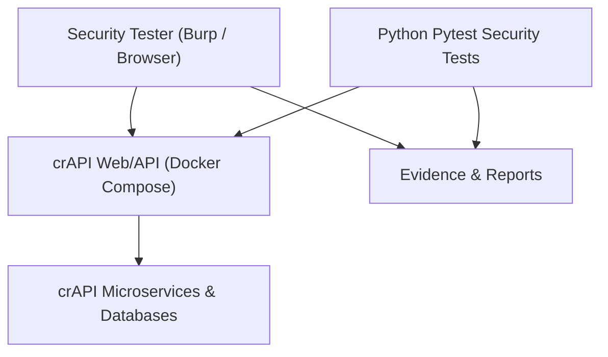

# Kiến trúc môi trường kiểm thử

## Sơ đồ tổng quan

## Các thành phần

| Thành phần | Chức năng | Nơi triển khai |
|---|---|---|
| crAPI | Hệ thống Web/API cố ý có lỗ hổng | Upstream OWASP, Docker Compose |
| Burp Suite | Quan sát/chỉnh sửa HTTP traffic trong Lab | Máy của sinh viên |
| Pytest + httpx | Security test tự viết | Repo nhóm |
| OWASP ZAP | Quét bổ sung, không bắt buộc để xác minh logic flaws | Máy của sinh viên |
| Evidence/Report | Tổng hợp bằng chứng và phân tích | Repo nhóm (đã làm sạch) |

## Nguyên tắc thiết kế

1. CrAPI chạy cục bộ với `LISTEN_IP=127.0.0.1`.
2. Mỗi thành viên có instance riêng để tự tạo tài khoản và dữ liệu thử.
3. `tests/` là mã của nhóm; `.runtime/crapi/` chỉ là bản upstream được tải về và **không commit**.
4. Không sao chép nội dung triển khai của upstream vào repo nhóm nếu không cần thiết.
5. Các security regression tests kiểm tra **hành vi đúng cần có**, vì vậy có thể FAIL trên ứng dụng cố tình có lỗ hổng.

## Lý do không đưa Compose đầy đủ vào repo

crAPI gồm nhiều dịch vụ, database và cấu hình. Dùng Compose của chính upstream giảm nguy cơ thiếu service hay lệch phiên bản. Script `scripts/crapi.sh` cung cấp lệnh chung cho cả nhóm, trong khi thay đổi về kiến trúc upstream vẫn do upstream quản lý.
