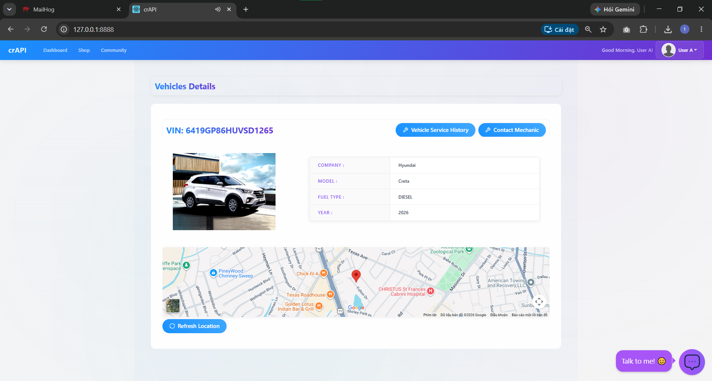
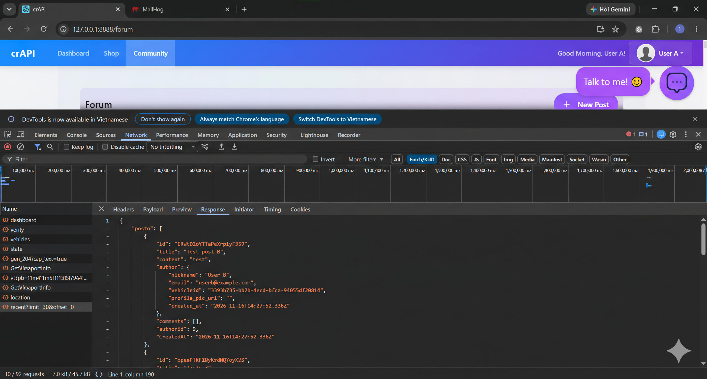
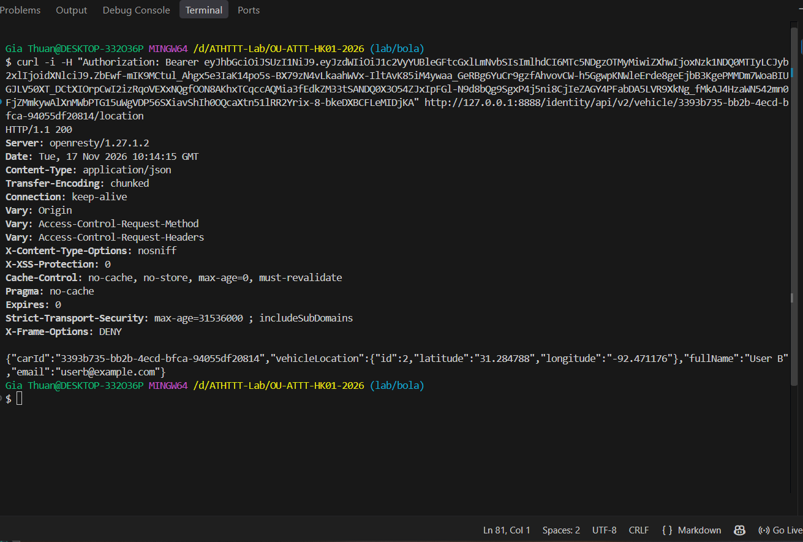
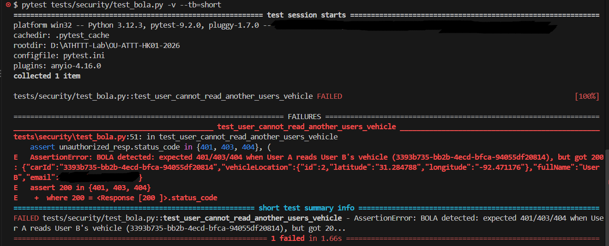

# LAB-01: Broken Object Level Authorization (BOLA)

> Khảo sát, khai thác và kiểm thử tự động lỗ hổng truy cập trái phép thông tin vị trí phương tiện trên OWASP crAPI

| Thành phần | Thông tin chi tiết |
|---|---|
| **Danh mục OWASP** | API1:2023 — Broken Object Level Authorization (BOLA) |
| **Thử thách crAPI** | Challenge #1 — Truy cập trái phép thông tin/vị trí phương tiện của người dùng khác |
| **Người thực hiện** | Gia Thuận |
| **Phiên bản / Nhánh** | Git commit `700f03d12a392d9e408260b4beae72ed02a4a1a4` (nhánh `lab/bola`) |

---

## 1. Mục tiêu và phạm vi

- **OWASP API Security:** API1:2023 — Broken Object Level Authorization (BOLA).
- **crAPI Challenge:** Challenge #1 — Truy cập trái phép thông tin và tọa độ vị trí phương tiện của người dùng khác thông qua định danh đối tượng (`vehicle_id`).
- **Mục tiêu:** Kiểm chứng khả năng một người dùng đã xác thực hợp lệ (User A) có thể trực tiếp gọi API truy vấn tọa độ vị trí GPS cùng thông tin cá nhân gắn với phương tiện thuộc sở hữu của người dùng khác (User B) bằng cách thay đổi tham số đường dẫn `{vehicle_id}` trong môi trường lab cục bộ.
- **Giới hạn:** Thực nghiệm trên 02 tài khoản thử nghiệm độc lập (User A và User B) trong môi trường crAPI local; phạm vi tập trung vào hành vi đọc trái phép dữ liệu (unauthorized read) trên endpoint vị trí phương tiện, chưa kiểm thử các thao tác ghi/điều khiển xe hoặc hệ thống sau khi áp dụng bản vá.

## 2. Lý thuyết

Broken Object Level Authorization (BOLA) là lỗ hổng kiểm soát truy cập xảy ra khi một API tiếp nhận định danh đối tượng (Object ID) do phía client truyền vào (thông qua tham số đường dẫn, chuỗi truy vấn hoặc nội dung yêu cầu) nhưng không kiểm tra xem người dùng đang thực hiện yêu cầu có quyền sở hữu hoặc quyền truy cập đối với đối tượng cụ thể đó hay không.

Trong OWASP API Security Top 10:2023, lỗ hổng này được xếp ở vị trí số một (**API1:2023**). Việc người dùng gửi kèm một mã xác thực (JWT token) hợp lệ chỉ chứng minh danh tính của người gọi (Authentication), hoàn toàn không đồng nghĩa với việc người đó được phép truy xuất mọi bản ghi trong hệ thống (Authorization).

- **Nguyên nhân thường gặp:**
  - Lập trình viên chỉ kiểm tra trạng thái đăng nhập của phiên làm việc mà bỏ qua bước đối chiếu quyền sở hữu tài nguyên ở tầng nghiệp vụ (`owner_id == current_user_id`).
  - Truy vấn trực tiếp cơ sở dữ liệu chỉ dựa trên `object_id` do client cung cấp mà không ràng buộc điều kiện định danh chủ sở hữu.
  - Các API công khai vô tình trả về định danh nội bộ của đối tượng (như `vehicleid`), tạo điều kiện cho kẻ tấn công thu thập chuỗi UUID mục tiêu.
- **Tác động và nguyên tắc phòng chống:** Lỗ hổng BOLA dẫn đến rò rỉ dữ liệu nhạy cảm của người dùng khác (vị trí địa lý theo thời gian thực, họ tên, địa chỉ email). Để phòng chống, máy chủ bắt buộc phải trích xuất định danh người dùng từ phiên đã xác thực ở phía server và ràng buộc quyền sở hữu trên mọi thao tác truy xuất đối tượng.

## 3. Môi trường thực nghiệm

Toàn bộ quá trình khảo sát, kiểm thử thủ công và chạy kiểm thử tự động được thực hiện trên hạ tầng cô lập cục bộ với các thông số ghi nhận trong bảng dưới đây:

| Thành phần | Cấu hình / Kết quả quan sát |
|---|---|
| **Ứng dụng** | OWASP crAPI (chế độ tối giản `CRAPI_MINIMAL=1`: `crapi-web`, `crapi-workshop`, `mailhog`, `mongodb`, `postgresdb`) |
| **URL cục bộ** | `http://127.0.0.1:8888` (Web/API) và `http://127.0.0.1:8025` (MailHog) |
| **Git commit crAPI** | `700f03d12a392d9e408260b4beae72ed02a4a1a4` (nhánh làm việc: `lab/bola`) |
| **Hệ điều hành & Ảo hóa** | Windows 10 (64-bit), Docker Desktop (WSL 2 backend) |
| **Công cụ khảo sát** | Google Chrome DevTools (tab Network — Fetch/XHR), Git Bash (`curl`) |
| **Kiểm thử tự động** | Python 3.12.3, `pytest` 9.2.0, `httpx` 0.28.1, `python-dotenv` 1.2.4 |
| **Tài khoản User A** | Tài khoản thử nghiệm truy vấn chéo; đã kích hoạt 01 phương tiện riêng qua MailHog (UUID xe: `22a84d75-033d-46b6-9d9f-8a92cf98ffb6`) |
| **Tài khoản User B** | Tài khoản chủ sở hữu mục tiêu; đã kích hoạt 01 phương tiện riêng qua MailHog (UUID xe: `3393b735-bb2b-4ecd-bfca-94055df20814`) và đăng 01 bài viết công khai (`"Test post B"`) trên Community |

## 4. Khảo sát chức năng bình thường

### 4.1. Mục đích nghiệp vụ và các endpoint liên quan

Chức năng quản lý phương tiện trên crAPI cho phép người dùng đã đăng nhập xem danh sách xe thuộc sở hữu cá nhân và truy vấn tọa độ GPS hiện tại của xe trên bản đồ Dashboard. Các endpoint chính tham gia vào luồng nghiệp vụ gồm:

- `GET /identity/api/v2/vehicle/vehicles` — Lấy danh sách phương tiện gắn với tài khoản đang đăng nhập.
- `GET /identity/api/v2/vehicle/{vehicle_id}/location` — Truy vấn tọa độ GPS (`latitude`, `longitude`) và thông tin chủ sở hữu của phương tiện theo định danh UUID `{vehicle_id}`.
- `GET /community/api/v2/community/posts/recent` — Lấy danh sách bài viết công khai trên diễn đàn Community (endpoint gián tiếp làm lộ định danh xe của tác giả bài viết).

Client gửi kèm mã thông báo xác thực trong HTTP Request Header theo chuẩn `Authorization: Bearer <JWT_TOKEN>` cùng tham số đường dẫn `{vehicle_id}`.

### 4.2. Truy vấn thông tin phương tiện hợp lệ của chính chủ (User A)

Khi User A truy cập Dashboard và tải vị trí phương tiện thuộc sở hữu của chính mình, trình duyệt gửi yêu cầu hợp lệ tới máy chủ:

```http
GET /identity/api/v2/vehicle/22a84d75-033d-46b6-9d9f-8a92cf98ffb6/location HTTP/1.1
Host: 127.0.0.1:8888
Authorization: Bearer <REDACTED_TOKEN_USER_A>
```

Phản hồi thực tế từ máy chủ: **`HTTP/1.1 200 OK`**.

```json
{
  "carId": "22a84d75-033d-46b6-9d9f-8a92cf98ffb6",
  "vehicleLocation": {
    "id": 2,
    "latitude": "31.284788",
    "longitude": "-92.471176"
  },
  "fullName": "User A",
  "email": "<REDACTED_EMAIL>"
}
```

### 4.3. Chính sách phân quyền kỳ vọng

Theo nguyên tắc thiết kế bảo mật chuẩn, endpoint `/identity/api/v2/vehicle/{vehicle_id}/location` chỉ được phép trả về dữ liệu khi `{vehicle_id}` thuộc quyền sở hữu của tài khoản tương ứng với JWT token trong header `Authorization`. Mọi yêu cầu truy vấn tới `{vehicle_id}` của người dùng khác bắt buộc phải bị từ chối bằng mã trạng thái HTTP `401`, `403` hoặc `404`.

## 5. Phương pháp kiểm thử: TC-01

### Bước 1: Khởi tạo tài khoản thử nghiệm và dữ liệu ban đầu

- Khởi động stack Docker crAPI cục bộ tại `http://127.0.0.1:8888` và hộp thư thử nghiệm MailHog tại `http://127.0.0.1:8025`.
- Đăng ký lần lượt 02 tài khoản độc lập (**User A** và **User B**), truy cập MailHog lấy cặp mã VIN và Pincode để kích hoạt phương tiện riêng cho từng tài khoản.
- Sử dụng phiên đăng nhập của **User B** đăng một bài viết công khai với nội dung `"Test post B"` trên diễn đàn **Community**.

**Mục đích:** Thiết lập hai chủ thể người dùng tách biệt với tài nguyên phương tiện độc lập và tạo điểm tiếp xúc dữ liệu công khai trên hệ thống.

**Hình 1: Giao diện Dashboard crAPI xác nhận tài khoản thử nghiệm đã kích hoạt phương tiện thành công**



### Bước 2: Khảo sát luồng công khai và thu thập định danh đối tượng

- Đăng nhập bằng tài khoản **User A**, mở Chrome DevTools → tab **Network** → bộ lọc **Fetch/XHR** và truy cập mục **Community**.
- Quan sát gói tin `GET /community/api/v2/community/posts/recent`, ghi nhận trường `vehicleid` của User B (`3393b735-bb2b-4ecd-bfca-94055df20814`) bị trả về công khai trong đối tượng `author` của bài viết.

**Mục đích:** Chứng minh kẻ tấn công có thể thu thập hợp lệ định danh UUID phương tiện của người dùng khác thông qua API bảng tin công khai.

**Hình 2: Response từ API Community công khai để lộ `vehicleid` của User B**



### Bước 3: Xác minh baseline truy cập hợp lệ trên phương tiện của User A

- Sử dụng JWT token của User A gửi yêu cầu `GET` tới đúng UUID phương tiện của User A (`22a84d75-033d-46b6-9d9f-8a92cf98ffb6`).
- Máy chủ phản hồi `HTTP 200 OK` với tọa độ và thông tin của User A, xác nhận token của User A đang hoạt động bình thường.

**Mục đích:** Thiết lập mốc đối chiếu chuẩn trước khi thay đổi tham số định danh sang đối tượng của người dùng khác.

### Bước 4: Thực hiện truy vấn chéo đối tượng bằng token của User A

Sử dụng công cụ dòng lệnh `curl` gửi yêu cầu truy vấn vị trí phương tiện của **User B** nhưng đính kèm mã xác thực của **User A**:

```http
GET /identity/api/v2/vehicle/3393b735-bb2b-4ecd-bfca-94055df20814/location HTTP/1.1
Host: 127.0.0.1:8888
Authorization: Bearer <REDACTED_TOKEN_USER_A>
```

**Điểm bất thường cần kiểm tra:** Client sử dụng phiên đăng nhập của User A để yêu cầu đọc dữ liệu của một `vehicle_id` không thuộc quyền sở hữu của mình.

**Hình 3: Kết quả kiểm chứng qua `curl` cho thấy User A đọc được tọa độ GPS và email của User B**



### Bước 5: Quan sát và phân tích phản hồi bất thường

Thay vì từ chối yêu cầu với mã lỗi phân quyền, máy chủ phản hồi trực tiếp **`HTTP/1.1 200 OK`** kèm toàn bộ dữ liệu nhạy cảm của User B:

```json
{
  "carId": "3393b735-bb2b-4ecd-bfca-94055df20814",
  "vehicleLocation": {
    "id": 2,
    "latitude": "31.284788",
    "longitude": "-92.471176"
  },
  "fullName": "User B",
  "email": "<REDACTED_EMAIL>"
}
```

### Bước 6: Đối chiếu kết quả kiểm thử

Bảng dưới đây tổng hợp sự đối chiếu giữa hành vi truy vấn chính chủ và hành vi truy vấn chéo đối tượng ghi nhận trong thực nghiệm:

| Tiêu chí | Truy vấn chính chủ | Truy vấn chéo (BOLA) | Diễn giải |
|---|---|---|---|
| **Token xác thực** | JWT của User A | JWT của User A | Cùng một phiên đăng nhập hợp lệ |
| **Target `vehicle_id`** | `22a84d75-...-ffb6` | `3393b735-...-0814` | Đổi sang UUID xe thuộc User B |
| **HTTP Status kỳ vọng** | `200 OK` | `401 / 403 / 404` | Chính sách kiểm soát truy cập chuẩn |
| **HTTP Status thực tế** | `200 OK` | `200 OK` | **Chấp nhận truy cập trái phép** |
| **Dữ liệu trả về** | GPS & email User A | GPS, tên & email User B | Rò rỉ vị trí và định danh cá nhân |

**Kết luận từ thực nghiệm:** Dữ liệu thực nghiệm khẳng định chắc chắn sự tồn tại của lỗ hổng Broken Object Level Authorization (BOLA) trên endpoint truy vấn vị trí phương tiện.

## 6. Kiểm thử tự động (Automated Security Test)

Để đảm bảo khả năng tái hiện và kiểm thử hồi quy tự động (regression testing) sau khi vá lỗi, nhóm đã xây dựng kịch bản kiểm thử bằng Python.

- **File kiểm thử:** `tests/security/test_bola.py` (hàm `test_user_cannot_read_another_users_vehicle`, sử dụng fixture `api_client` trong `tests/conftest.py` kết nối tới `http://127.0.0.1:8888`).
- **Tiền điều kiện:**
  - Các container Docker của crAPI đang chạy ở trạng thái `healthy`.
  - Đã cài đặt đầy đủ thư viện từ `requirements.txt` (`pytest`, `httpx`, `python-dotenv`).
  - Hai tài khoản thử nghiệm User A và User B (cấu hình qua các biến môi trường `CRAPI_USER_A_EMAIL`, `CRAPI_USER_A_PASSWORD`, `CRAPI_USER_B_EMAIL`, `CRAPI_USER_B_PASSWORD` hoặc giá trị mặc định cục bộ) đã được kích hoạt phương tiện riêng.
- **Cách thực thi và kết quả mong đợi:** Chạy lệnh `pytest tests/security/test_bola.py -v`. Bài kiểm thử khẳng định chính sách an toàn `assert unauthorized_resp.status_code in {401, 403, 404}`. Trên hệ thống crAPI chưa vá lỗi, bài test sẽ báo **`FAILED`** tại dòng kiểm tra này.
- **Kết quả thực tế ghi nhận:** Thực thi trên commit `700f03d12a392d9e408260b4beae72ed02a4a1a4` cho kết quả `1 failed in 4.05s` (đã ẩn địa chỉ email trong log):

```text
tests/security/test_bola.py::test_user_cannot_read_another_users_vehicle FAILED [100%]

AssertionError: BOLA detected: expected 401/403/404 when User A reads User B's vehicle
(3393b735-bb2b-4ecd-bfca-94055df20814), but got 200:
{"carId":"3393b735-bb2b-4ecd-bfca-94055df20814",
 "vehicleLocation":{"id":2,"latitude":"31.284788","longitude":"-92.471176"},
 "fullName":"User B","email":"<REDACTED_EMAIL>"}
assert 200 in {401, 403, 404}
```

- **Ý nghĩa các trạng thái PASS / FAIL / SKIP:**
  - **`FAILED`:** Hệ thống mục tiêu đang tồn tại lỗ hổng BOLA — máy chủ cho phép tài khoản A đọc trái phép tài nguyên phương tiện của tài khoản B (`HTTP 200`) thay vì từ chối.
  - **`PASSED`:** Máy chủ đã kiểm tra quyền sở hữu đối tượng đúng chuẩn và từ chối yêu cầu truy cập trái phép bằng mã trạng thái `401`, `403` hoặc `404`.
  - **`SKIP`:** Bài kiểm thử chưa được kích hoạt hoặc môi trường mục tiêu chưa sẵn sàng để chạy kiểm tra hồi quy.

**Hình 4: Kết quả chạy kiểm thử tự động `pytest` phát hiện lỗ hổng BOLA (HTTP 200)**



## 7. Phân tích nguyên nhân

1. **Thiếu kiểm tra quyền sở hữu ở endpoint vị trí xe:** Tại endpoint `GET /identity/api/v2/vehicle/{vehicle_id}/location`, dịch vụ `identity-service` chỉ xác thực chữ ký và thời hạn của JWT token (kiểm tra người gọi đã đăng nhập hay chưa) mà hoàn toàn không đối chiếu quyền sở hữu giữa định danh người dùng trong JWT với chủ sở hữu của `{vehicle_id}` truyền trên URL.
2. **Lộ định danh nội bộ qua API công khai:** Endpoint `GET /community/api/v2/community/posts/recent` của dịch vụ `community-service` tuần tự hóa và trả về trường `vehicleid` của tác giả bài viết ra giao diện công khai, giúp bất kỳ người dùng nào cũng có thể thu thập định danh xe của người khác.
3. **Các lớp kiến trúc cần khắc phục:**
   - *Tầng Service / Controller (`identity-service`):* Bắt buộc bổ sung bước xác minh quyền sở hữu tài nguyên trước khi trả dữ liệu vị trí phương tiện.
   - *Tầng Database / Repository:* Truy vấn bản ghi phương tiện theo cặp điều kiện kết hợp cả định danh xe và định danh chủ sở hữu.
   - *Tầng DTO / Serializer (`community-service`):* Loại bỏ trường `vehicleid` khỏi cấu trúc dữ liệu phản hồi của API bảng tin công khai.
4. **Phạm vi đã chứng minh và chưa chứng minh:** Đã chứng minh người dùng bất kỳ có thể đọc trái phép tọa độ GPS (`latitude`, `longitude`), họ tên (`fullName`) và địa chỉ `email` của người dùng khác. Chưa kiểm thử các thao tác ghi/sửa/xóa trái phép trên tài nguyên phương tiện khác hoặc kết quả sau khi vá lỗi.

## 8. Biện pháp khắc phục

1. **Kiểm tra quyền sở hữu ở tầng nghiệp vụ (`identity-service`):** Khi tiếp nhận yêu cầu `GET /identity/api/v2/vehicle/{vehicle_id}/location`, trích xuất định danh người dùng hiện tại (`currentUserId`) từ `SecurityContext` / JWT đã xác thực phía server, sau đó đối chiếu với `owner_id` của đối tượng `Vehicle`. Nếu không trùng khớp, từ chối ngay với mã `403 Forbidden` (hoặc `404 Not Found` để tránh lộ sự tồn tại của tài nguyên).
2. **Ràng buộc truy vấn ở tầng cơ sở dữ liệu:** Thay thế các truy vấn chỉ tìm kiếm theo `vehicle_id` bằng truy vấn gắn liền chủ sở hữu (ví dụ `findByUuidAndOwnerId(vehicleId, currentUserId)` hoặc mệnh đề `WHERE uuid = :vehicle_id AND owner_id = :current_user_id`).
3. **Giảm thiểu dữ liệu lộ lọt (Data Minimization) ở `community-service`:** Lược bỏ trường `vehicleid` khỏi đối tượng `author` trong DTO phản hồi của endpoint `/community/api/v2/community/posts/recent`.
4. **Kiểm thử lại sau khi sửa (Retest):** Sau khi áp dụng bản vá và khởi động lại dịch vụ `identity-service`, chạy lại lệnh `pytest tests/security/test_bola.py -v`. Bản vá đạt yêu cầu khi endpoint trả về mã HTTP `403` hoặc `404`, không rò rỉ dữ liệu vị trí/email của User B, và bài kiểm thử tự động chuyển từ `FAILED` sang `PASSED`.

## 9. Kết luận và tham khảo

### 9.1. Kết luận dựa trên bằng chứng

Qua quá trình khảo sát thực nghiệm và chạy kiểm thử tự động trên OWASP crAPI (commit `700f03d12a392d9e408260b4beae72ed02a4a1a4`), đã chứng minh chắc chắn sự tồn tại của lỗ hổng **Broken Object Level Authorization (OWASP API1:2023)** tại endpoint `GET /identity/api/v2/vehicle/{vehicle_id}/location`. Kết hợp với việc `GET /community/api/v2/community/posts/recent` để lộ `vehicleid` của tác giả bài viết, bất kỳ người dùng đã đăng nhập nào cũng có thể thu thập định danh xe và truy xuất trái phép tọa độ GPS cùng địa chỉ email của người dùng khác.

### 9.2. Tài liệu tham khảo

1. OWASP API Security Top 10 (2023) — *API1:2023 Broken Object Level Authorization*: https://owasp.org/API-Security/editions/2023/en/0xa1-broken-object-level-authorization/
2. OWASP crAPI (Completely Ridiculous API) Official Repository & Challenges Documentation: https://github.com/OWASP/crAPI