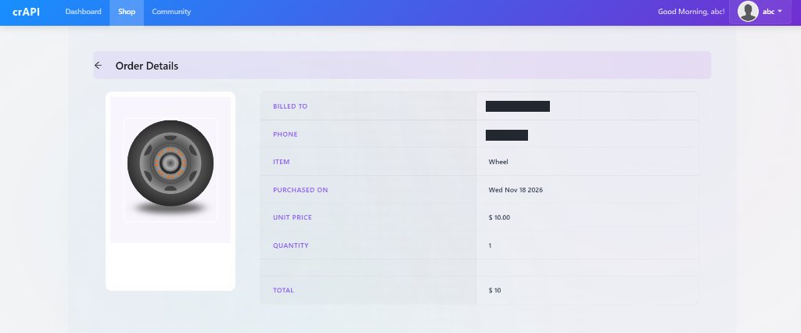
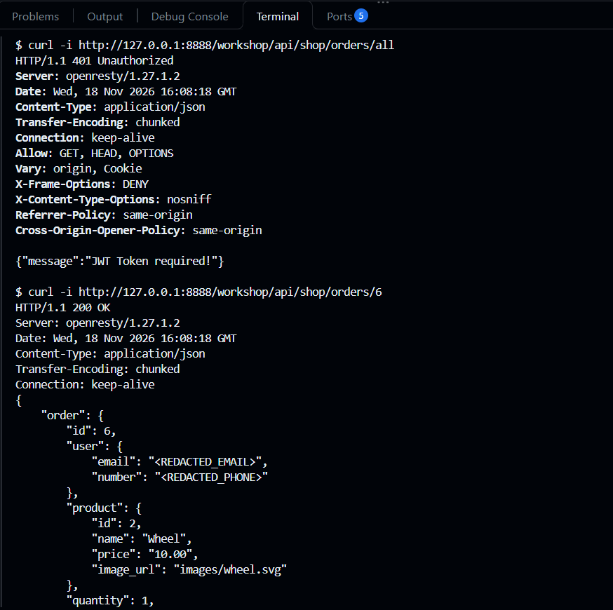
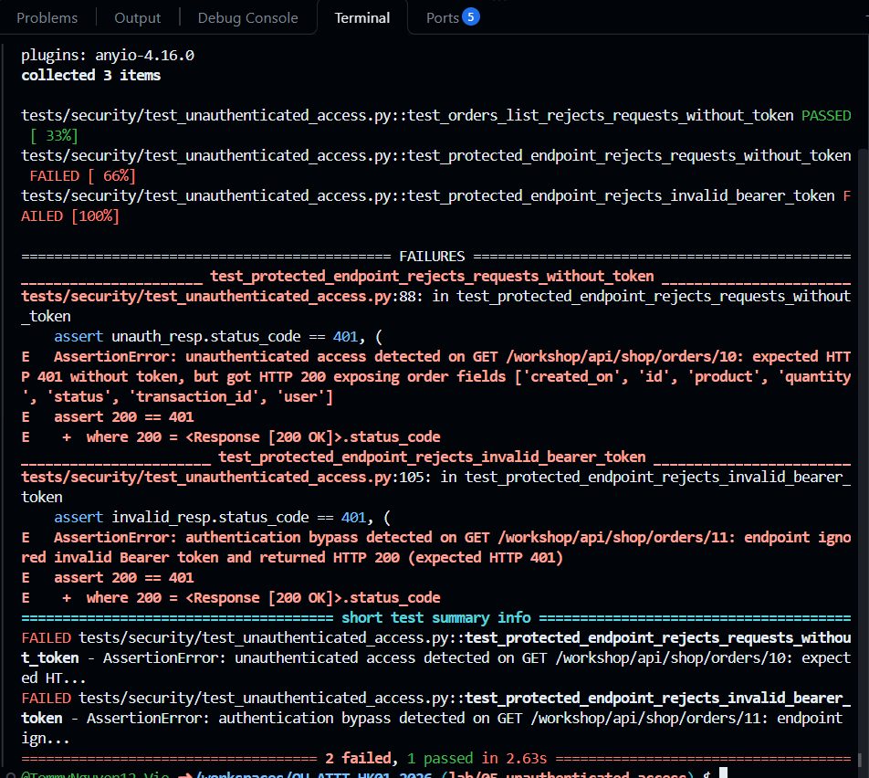

# LAB-05 — Báo cáo Unauthenticated Access

## 1. Mục tiêu và phạm vi

- **OWASP API Security category:** API2:2023 — Broken Authentication (API2:2019 — Broken User Authentication).
- **crAPI challenge:** Challenge #14 — Find an endpoint that does not perform authentication checks for a user.
- **Tác động cần kiểm chứng:** Kiểm chứng việc client không cần đăng nhập (không gửi header `Authorization` hoặc gửi Bearer token không hợp lệ) vẫn truy xuất được chi tiết đơn hàng qua endpoint `GET /workshop/api/shop/orders/{order_id}` trong môi trường lab cục bộ.

## 2. Lý thuyết

- **Khái niệm:** Unauthenticated Access xảy ra khi một API nghiệp vụ đáng lẽ chỉ phục vụ người dùng đã đăng nhập nhưng lại bỏ sót bước xác minh danh tính người gọi (Authentication). Theo chuẩn HTTP (RFC 9110), cần phân biệt rõ hai mã trạng thái:
  - `401 Unauthorized`: yêu cầu chưa được xác thực danh tính (thiếu thông tin xác thực, token sai chữ ký hoặc hết hạn).
  - `403 Forbidden`: máy chủ đã xác thực danh tính người gọi nhưng từ chối cấp quyền thực hiện thao tác.
- **Nguyên nhân thường gặp:**
  - Framework cấu hình mặc định mở (`AllowAny`), buộc lập trình viên phải gắn decorator xác thực thủ công cho từng phương thức và dễ bỏ sót.
  - Gắn kiểm tra xác thực không đồng nhất giữa các HTTP method (`POST`, `PUT`, `GET`) trong cùng một view/controller.
  - API Gateway chỉ chuyển tiếp request vào microservice mà không kiểm tra JWT tập trung.
  - Giao diện frontend luôn tự động đính kèm `Authorization: Bearer <token>`, khiến kiểm thử chức năng thông thường trên trình duyệt không phát hiện được lỗi thiếu xác thực ở backend.
- **Biện pháp phòng chống:**
  - Áp dụng cơ chế xác thực tập trung theo nguyên tắc *Deny-by-Default* (mặc định yêu cầu xác thực trên toàn bộ API, chỉ khai báo allowlist tường minh cho các endpoint công khai như `/login`, `/signup`, `/health`).
  - Bổ sung kiểm thử tự động xác nhận mọi endpoint bảo vệ đều trả `401 Unauthorized` khi thiếu hoặc sai token.

## 3. Môi trường thực nghiệm

- **Git commit crAPI:** `700f03d12a392d9e408260b4beae72ed02a4a1a4` (`OWASP/crAPI`, triển khai cục bộ qua `bash scripts/crapi.sh up` tại `http://127.0.0.1:8888`, nhánh `lab/05-unauthenticated-access`).
- **Công cụ, phiên bản:** Docker Compose, Google Chrome DevTools, `curl`, `Python 3.12+`, `pytest`, `httpx`, `python-dotenv`.
- **Tài khoản thử nghiệm/điều kiện ban đầu (không ghi credentials):** Tài khoản thử nghiệm cục bộ được tạo mới tự động với credit khởi tạo `$100.0` và đặt mua 01 sản phẩm mẫu (`Wheel`, `product_id=2`, giá `$10.00`) để sinh đơn hàng hợp lệ phục vụ kiểm thử.

## 4. Khảo sát chức năng bình thường

- **Mục đích nghiệp vụ:** Người dùng sau khi đăng nhập vào mục **Shop** có thể đặt mua phụ tùng, xem danh sách đơn hàng và mở trang **Order Details** để xem chi tiết từng đơn hàng. Trên trình duyệt (`services/web/src/sagas/shopSaga.ts::getOrderById`), ứng dụng web luôn gửi kèm header `Authorization: Bearer <JWT>`.
- **Endpoint liên quan:**
  - `POST /workshop/api/shop/orders` — Tạo đơn hàng mới (có yêu cầu JWT).
  - `GET /workshop/api/shop/orders/all` — Lấy danh sách đơn hàng của tài khoản đang đăng nhập (endpoint đối chứng, có gắn `@jwt_auth_required`).
  - `GET /workshop/api/shop/orders/{order_id}` — Lấy chi tiết đơn hàng theo `order_id` (endpoint mục tiêu của Challenge #14).
- **Request/response hợp lệ:** Khi gửi kèm `Authorization: Bearer <REDACTED_JWT>`, `GET /workshop/api/shop/orders/6` trả `HTTP 200 OK` chứa thông tin `order` và `payment` (chi tiết đã làm sạch tại [evidence/http-requests-responses.md](evidence/http-requests-responses.md)).

## 5. Phương pháp kiểm thử

1. **Thiết lập điều kiện thử:** Đăng ký tài khoản thử nghiệm cục bộ, đăng nhập lấy JWT và tạo 01 đơn hàng mẫu để có `order_id` hợp lệ.
2. **Thực hiện kiểm thử có kiểm soát:**
   - **Đối chứng (Control):** Gửi `GET /workshop/api/shop/orders/all` không kèm header `Authorization` để xác nhận cơ chế kiểm tra JWT của dịch vụ `workshop` đang hoạt động.
   - **Vector A (Missing token):** Gửi `GET /workshop/api/shop/orders/{order_id}` hoàn toàn không có header `Authorization` và không có cookie.
   - **Vector B (Invalid token):** Gửi `GET /workshop/api/shop/orders/{order_id}` kèm header `Authorization: Bearer invalid.jwt.token`.
3. **Dấu hiệu xác nhận lỗ hổng:** Endpoint đối chứng `/orders/all` từ chối với `HTTP 401 Unauthorized`, trong khi `GET /workshop/api/shop/orders/{order_id}` ở cả Vector A và Vector B đều trả `HTTP 200 OK` kèm toàn bộ chi tiết đơn hàng.
4. **Cách tái hiện:**
   ```bash
   bash scripts/crapi.sh up
   pytest tests/security/test_unauthenticated_access.py -v --tb=short
   ```

## 6. Bằng chứng

Toàn bộ ảnh chụp màn hình và bản ghi HTTP đã che kín JWT, email, số điện thoại tại thư mục [evidence/](evidence/README.md):

1. **Giao diện Order Details hợp lệ trên Web** ([evidence/01-shop-order-details-ui.png](evidence/01-shop-order-details-ui.png)):

   

2. **Đối chứng `401 Unauthorized` tại `/orders/all` và truy cập không cần xác thực `200 OK` tại `/orders/6` bằng `curl`** ([evidence/02-curl-unauthenticated-access.png](evidence/02-curl-unauthenticated-access.png)):

   

3. **Kết quả chạy kiểm thử tự động `pytest`** ([evidence/03-pytest-security-result.png](evidence/03-pytest-security-result.png)):

   

4. **Bản ghi HTTP Request/Response đã làm sạch:** [evidence/http-requests-responses.md](evidence/http-requests-responses.md).

## 7. Phân tích nguyên nhân

- **Điểm kiểm soát bị thiếu trong mã nguồn crAPI:**
  - Tại `services/workshop/crapi/shop/views.py` (`OrderControlView`): các phương thức `post` (dòng 167) và `put` (dòng 218) đều được gắn decorator `@jwt_auth_required`, và `OrderDetailsView.get` xử lý `/orders/all` (dòng 267) cũng có `@jwt_auth_required`. Tuy nhiên, phương thức `OrderControlView.get` (dòng 109) xử lý `GET /workshop/api/shop/orders/{order_id}` bị bỏ sót `@jwt_auth_required` dù docstring (dòng 114) ghi rõ endpoint yêu cầu JWT.
  - Tại `services/workshop/crapi_site/settings.py` (dòng 128–136): cấu hình `REST_FRAMEWORK` không khai báo `DEFAULT_AUTHENTICATION_CLASSES` và `DEFAULT_PERMISSION_CLASSES`, khiến Django REST Framework mặc định cho phép truy cập tự do (`AllowAny`) đối với bất kỳ view nào quên gắn decorator.
  - Tại `services/web/nginx.conf.template` (dòng 165–181): Nginx reverse proxy chuyển tiếp trực tiếp `/workshop/` vào microservice mà không thực thi xác thực tại tầng gateway.
- **Lớp kiến trúc cần khắc phục:** Tầng cấu hình xác thực mặc định của framework (DRF settings/authentication class) kết hợp decorator xác thực tại tầng View/Controller.
- **Phạm vi tác động đã chứng minh:** Bất kỳ client nào không cần tài khoản hợp lệ đều có thể gọi trực tiếp `GET /workshop/api/shop/orders/{order_id}` và nhận phản hồi `HTTP 200 OK` chứa dữ liệu đơn hàng.
- **Giới hạn phạm vi:** Các phương thức thay đổi trạng thái đơn hàng (`POST`, `PUT`) trên cùng view vẫn có `@jwt_auth_required` nên người gọi không xác thực không thể tạo hoặc cập nhật đơn hàng; bài lab chỉ kiểm thử trên bản crAPI gốc chưa áp dụng bản vá.

## 8. Biện pháp khắc phục

- **Áp dụng xác thực tập trung (Deny-by-Default):** Chuyển cơ chế kiểm tra JWT trong `services/workshop/utils/jwt.py` thành lớp `BaseAuthentication` chuẩn của Django REST Framework và cấu hình mặc định bắt buộc đăng nhập trong `services/workshop/crapi_site/settings.py`:
  ```python
  REST_FRAMEWORK = {
      "DEFAULT_AUTHENTICATION_CLASSES": ["utils.jwt.CustomJWTAuthentication"],
      "DEFAULT_PERMISSION_CLASSES": ["rest_framework.permissions.IsAuthenticated"],
  }
  ```
  Chỉ gắn `@permission_classes([AllowAny])` tường minh cho các endpoint thực sự công khai (như healthcheck).
- **Bổ sung kiểm tra xác thực tại `OrderControlView.get`:** Gắn `@jwt_auth_required` cho `OrderControlView.get` tương tự `post`, `put` và `OrderDetailsView.get` để từ chối ngay bằng `401 Unauthorized` khi request thiếu hoặc dùng JWT không hợp lệ.
- **Cách kiểm thử lại sau khi sửa:** Chạy lại `pytest tests/security/test_unauthenticated_access.py -v`; toàn bộ 3 test case phải đạt trạng thái `PASSED` (endpoint trả đúng `401 Unauthorized` cho cả trường hợp thiếu token và token sai).

## 9. Automated security test

- **File test:** [tests/security/test_unauthenticated_access.py](../../tests/security/test_unauthenticated_access.py) (marker `@pytest.mark.security`, đã gỡ bỏ `skip`).
- **Tiền điều kiện:** Hệ thống crAPI cục bộ đang chạy tại `CRAPI_BASE_URL` (mặc định `http://127.0.0.1:8888`); bộ test tự đăng ký tài khoản thử và tạo đơn hàng mẫu độc lập trong mỗi lần chạy.
- **Kết quả mong đợi trên vulnerable target:**
  - `test_orders_list_rejects_requests_without_token`: **`PASSED`** (endpoint đối chứng `/workshop/api/shop/orders/all` trả đúng `401`).
  - `test_protected_endpoint_rejects_requests_without_token`: **`FAILED`** (endpoint mục tiêu trả `200` thay vì `401` khi không có token).
  - `test_protected_endpoint_rejects_invalid_bearer_token`: **`FAILED`** (endpoint mục tiêu bỏ qua Bearer token sai và trả `200` thay vì `401`).
- **Kết quả thực tế:** Chạy trên crAPI commit `700f03d` đạt `2 failed, 1 passed in 2.63s`:
  - `test_orders_list_rejects_requests_without_token`: `PASSED`
  - `test_protected_endpoint_rejects_requests_without_token`: `FAILED` (`AssertionError: unauthenticated access detected on GET /workshop/api/shop/orders/10: expected HTTP 401 without token, but got HTTP 200 ...`)
  - `test_protected_endpoint_rejects_invalid_bearer_token`: `FAILED` (`AssertionError: authentication bypass detected on GET /workshop/api/shop/orders/11: endpoint ignored invalid Bearer token and returned HTTP 200 (expected HTTP 401)`)
- **Ý nghĩa PASS/FAIL/SKIP:**
  - **`FAILED`** trên 2 test mục tiêu: chứng minh tự động rằng crAPI đang tồn tại lỗ hổng thiếu kiểm tra xác thực tại `GET /workshop/api/shop/orders/{order_id}`.
  - **`PASSED`** trên test đối chứng: xác nhận dịch vụ và cơ chế kiểm tra JWT của môi trường lab vẫn hoạt động bình thường; cả 3 test chỉ đồng loạt `PASSED` sau khi lỗ hổng đã được vá.
  - **`SKIP`**: đã được loại bỏ vì toàn bộ test đã cài đặt hoàn chỉnh và chạy thật.

## 10. Kết luận và tham khảo

- **Kết luận:** Thực nghiệm thủ công và kiểm thử tự động trên crAPI cục bộ đã xác nhận lỗ hổng **Unauthenticated Access (OWASP API2:2023 — Broken Authentication, Challenge #14)** tại `GET /workshop/api/shop/orders/{order_id}` do thiếu xác thực mặc định toàn cục trong Django REST Framework và bỏ sót decorator `@jwt_auth_required` trên `OrderControlView.get`.
- **Tài liệu tham khảo:**
  - OWASP API Security Top 10 (2023) — *API2:2023 Broken Authentication*: https://owasp.org/API-Security/editions/2023/en/0xa2-broken-authentication/
  - IETF RFC 9110 — *HTTP Semantics (Status Codes `401 Unauthorized` & `403 Forbidden`)*: https://www.rfc-editor.org/rfc/rfc9110#name-401-unauthorized
  - OWASP crAPI Official Repository (`docs/challenges.md` — Challenge 14 & `services/workshop/crapi/shop/views.py`): https://github.com/OWASP/crAPI
